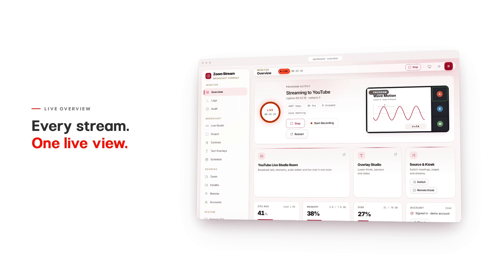
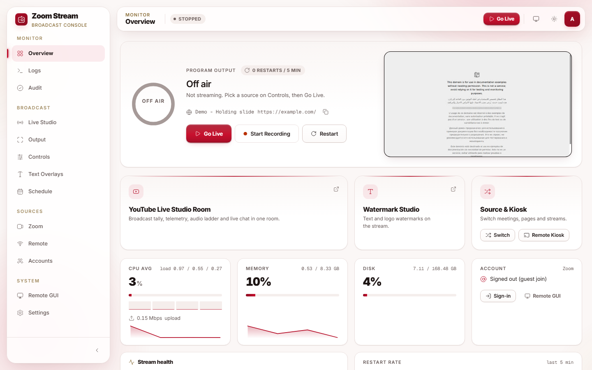
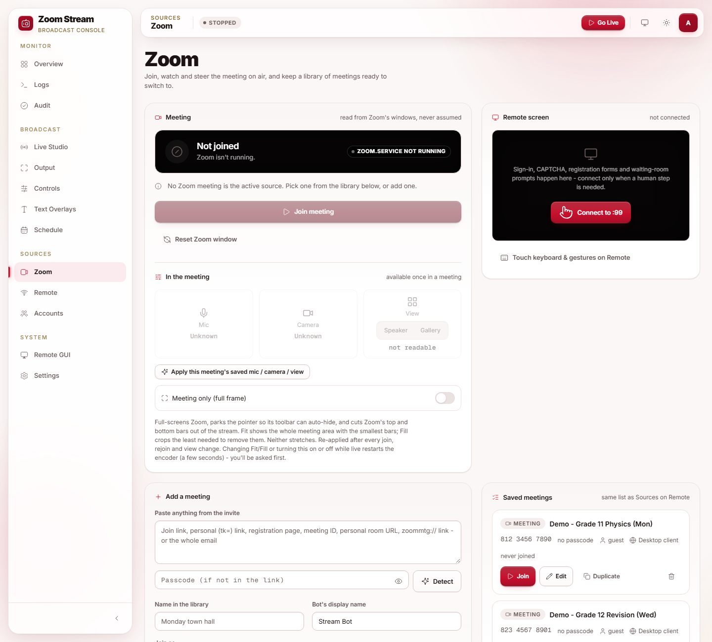
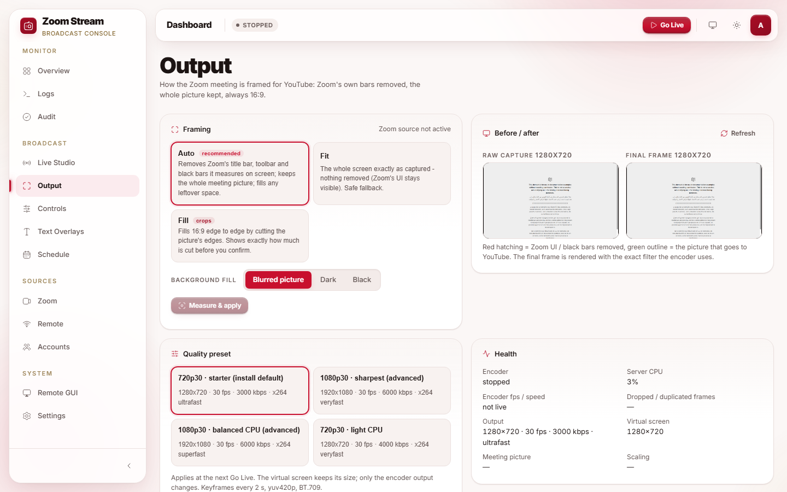
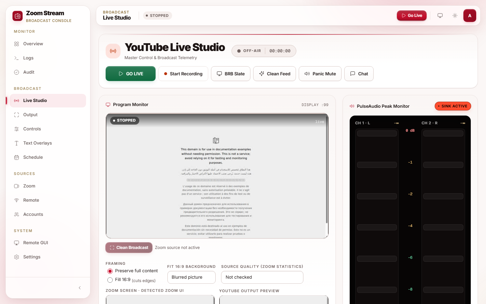
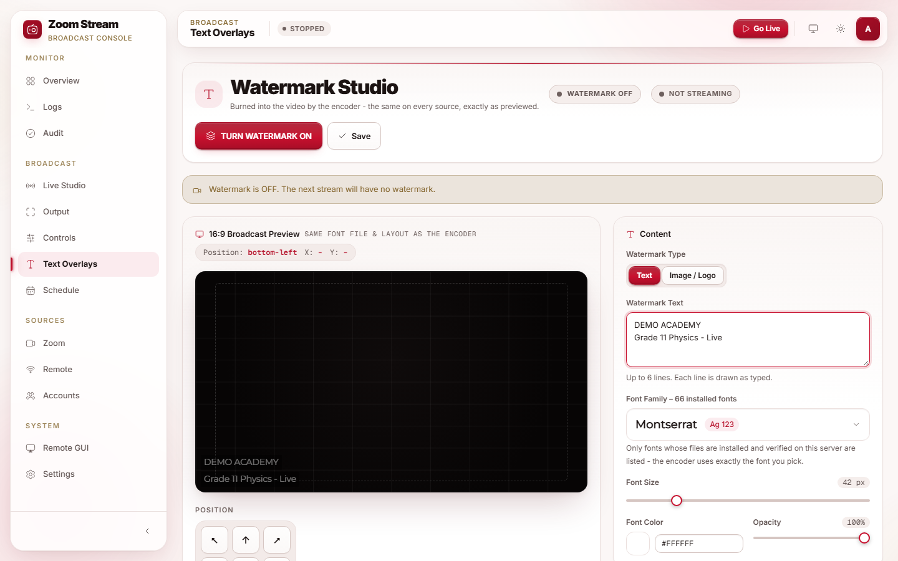
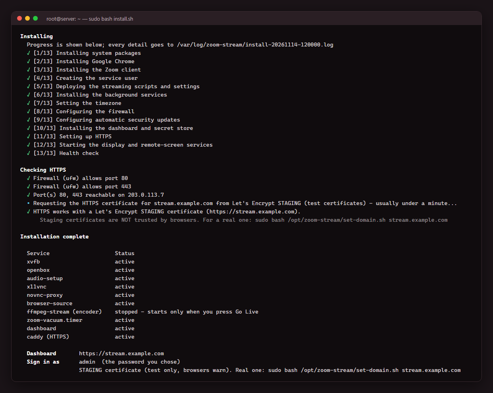

<p align="center">
  
</p>

<h1 align="center">Zoom to YouTube Live Streaming</h1>

<p align="center">
  Stream a Zoom meeting, a web page or a media feed to YouTube Live from your own server,<br>
  with a web dashboard to control everything.
</p>

<p align="center">
  <a href="LICENSE"></a>
  <a href="https://github.com/OWNER/REPO/actions/workflows/ci.yml"></a>
  
  
  
</p>

---

## What it does

A small Linux server joins your Zoom meeting as a participant (or opens a web page), draws it on a virtual screen,
and streams that screen and its audio to YouTube Live. You run everything from a browser: pick the meeting, check the
picture, add a watermark, schedule the start, and press **Go Live**.

It is meant for people who need to restream a meeting they are **allowed to share** - classes, talks, community
events - when they are not the host or cannot use Zoom's own "Live on Custom Streaming Service". If you are the host,
Zoom's built-in streaming is simpler and needs no server. Please read [Responsible use](#responsible-use).

## Features

- **Three kinds of source** - a Zoom meeting (desktop client or Zoom's web client), any web page in a Chrome kiosk,
  or a direct media URL (HLS, RTMP/RTMPS, SRT, file) that FFmpeg reads itself.
- **Go Live with confirmation** - nothing is ever broadcast automatically. Going live needs an explicit, confirmed
  click; a start permission is single-use and expires after 60 seconds.
- **Clean meeting picture** - hide Zoom's toolbars and title bar, *Fit* (whole meeting, thin bars) or *Fill*
  (no bars, slight crop), measured black-border detection, and an *Output* page with Auto/Fit/Fill framing.
- **Live Studio** - broadcast status, bitrate/FPS/dropped-frame telemetry, an audio peak meter, a local test
  recording, and the YouTube live chat in one page.
- **Watermark Studio** - text or logo burned into the video by the encoder, 66 bundled open-licence fonts, colour,
  outline, box, shadow and a 9-point or free position. The preview uses the same font files as the encoder.
- **Scheduling** - join the meeting early and stop and leave at the end automatically. Going live stays your own
  confirmed click: a schedule prepares the meeting, it never starts the broadcast.
- **Remote GUI** - see and control the bot's screen inside the dashboard (noVNC through the dashboard's own login).
- **Google accounts** - separate Chrome profiles for Google sign-in (for "Sign in with Google" meetings or
  sign-in-only YouTube videos), with a session check that tells you if a profile was signed out.
- **Recording and alerts** - record the program output locally; optional Telegram notifications and uploads.
- **Operations built in** - redacted live logs, an audit log of every change, automatic restart of failed
  services, daily disk clean-up, backups with checksums, one-command updates with automatic rollback, and a
  `doctor.sh` that explains problems in plain words.
- **Secure defaults** - HTTPS (Let's Encrypt or self-signed), argon2 password hashing, login lockout, CSRF
  protection, an encrypted secret store, and a narrow sudo allowlist between the dashboard and the streaming user.

## Screenshots

| Overview | Zoom | Output framing |
|---|---|---|
|  |  |  |

| Live Studio | Watermark Studio | Installer |
|---|---|---|
|  |  |  |

*Screenshots use demo data.*

## Requirements

| | Minimum | Recommended |
|---|---|---|
| Server | Ubuntu **24.04 LTS**, x86_64, with systemd (a VPS or VM, not a container) | |
| CPU | 2 cores (720p only) | **4 dedicated cores** for 720p, 8+ for 1080p |
| Memory | 4 GB | 8 GB |
| Disk | 10 GB free | 20 GB+ (recordings need more) |
| Network | Ports 443 (and 80 for Let's Encrypt) reachable; outbound HTTPS | |
| Accounts | A YouTube channel with live streaming enabled; a Zoom link you may join | A domain name |

There is no GPU: Zoom or Chrome paints every frame on the CPU, which is usually the biggest load. Start with 720p and
measure before raising it - see [Performance](docs/faq.md#how-much-cpu-does-it-need).

## Install

On a fresh Ubuntu 24.04 server, as a user with sudo:

```bash
curl -fsSL https://raw.githubusercontent.com/OWNER/REPO/main/install.sh -o install.sh
sudo bash install.sh
```

The installer downloads the project with `git` into `/opt/zoom-stream` and continues from there. You can also clone
first: `sudo git clone https://github.com/OWNER/REPO.git /opt/zoom-stream && sudo /opt/zoom-stream/install.sh`.

It checks the server, asks a few questions, shows a summary to confirm, then installs everything from official sources
(about 10-20 minutes). If anything fails it tells you which step, why, and how to continue - running it again resumes
where it stopped. New to servers? Follow the step-by-step **[installation guide](docs/installation.md)**.

### What the installer asks

```
Checking this server
  ✓ Running as root
  ✓ Operating system: Ubuntu 24.04.1 LTS
  ✓ CPU cores: 4
  ✓ Memory: 7.6 GB
  ✓ Free disk space: 71 GB
  ✓ Required ports are free (80, 443, 8000, 5900, 6080, 9222)
  ✓ Download sources reachable (Ubuntu, Google, Zoom, PyPI, GitHub)
  ✓ YouTube live ingest reachable (a.rtmps.youtube.com:443)

Domain name                   stream.example.com   (checks that DNS points here, or 'none')
HTTPS certificate             letsencrypt / self-signed
Dashboard admin username      admin
Dashboard admin password      (hidden, typed twice, strength-checked)
YouTube ingest server         rtmps://a.rtmps.youtube.com:443/live2
YouTube stream key            (hidden, or Enter = set later in the dashboard)
Zoom display name             Stream Bot
Output quality                720p / 1080p (recommended from your CPU count)
Timezone                      (detected)
Remote screen (VNC) password  (hidden, or Enter = generate)
Master encryption password    (hidden, or Enter = generate)
Firewall (ufw)                yes / no
Automatic security updates    yes / no

Summary -> [Enter] install   [1-12] change an answer   [q] cancel
```

For automation, put the same answers in a file and run `sudo ./install.sh --config my.conf`
(see [installer/config.example](installer/config.example)).

## Quick start

1. Open the dashboard address the installer printed and sign in.
2. **Live Studio** - paste your YouTube stream key if you skipped it during installation.
3. **Zoom** - paste a meeting link (or a whole invitation) and press **Join**. Open **Remote GUI** to watch the bot.
4. **Output** - choose Fit or Fill; the preview shows exactly what YouTube will get.
5. **Live Studio** - make a 60-second **test recording** and check picture and sound.
6. Press **Go Live** and confirm. Press **Stop** when you are done.

More in the [usage guide](docs/usage.md).

## Day-to-day commands

```bash
sudo /opt/zoom-stream/doctor.sh      # check everything and explain problems
sudo /opt/zoom-stream/update.sh      # update to the newest release (backup + automatic rollback)
sudo /opt/zoom-stream/backup.sh      # back up settings, database and encrypted secrets
sudo /opt/zoom-stream/restore.sh     # restore a backup
sudo /opt/zoom-stream/uninstall.sh   # remove it (asks before deleting any data)
```

## Documentation

| Guide | |
|---|---|
| [Installation](docs/installation.md) | Server, DNS, HTTPS, YouTube stream key, Zoom - step by step |
| [Usage](docs/usage.md) | Every dashboard page |
| [Configuration](docs/configuration.md) | Settings, files and options |
| [Updating](docs/updating.md) | Updates and rollback |
| [Backup and restore](docs/backup-restore.md) | What is saved and how to restore |
| [Troubleshooting](docs/troubleshooting.md) | Common problems and fixes |
| [Architecture](docs/architecture.md) | How the pieces fit together |
| [Security](docs/security.md) and [encryption](docs/encryption.md) | What is protected, and how |
| [Watermark](docs/watermark.md) | How the watermark reaches the video |
| [First live test](docs/first-live-test.md) | A checklist for your first real meeting |
| [FAQ](docs/faq.md) | Short answers |
| [Testing](docs/testing.md) | What has been tested, and what has not |

## Responsible use

Only stream meetings you have the right to share. Tell the host and participants before you go live - recording or
broadcasting people without consent may break platform rules, your organisation's policies or the law where you live.
This project does nothing a human participant could not do by hand: it does not bypass waiting rooms, host approval,
passcodes or authentication, and it never types passwords for you. Zoom, YouTube and Google are trademarks of their
owners; this project is not affiliated with or endorsed by them.

## Contributing

Issues and pull requests are welcome - see [CONTRIBUTING.md](CONTRIBUTING.md) and the
[Code of Conduct](CODE_OF_CONDUCT.md). Report security problems privately as described in [SECURITY.md](SECURITY.md).

## License and credits

[MIT](LICENSE) © 2026 Nimesh Piyathissa.

Built on [FFmpeg](https://ffmpeg.org), [FastAPI](https://fastapi.tiangolo.com), [Caddy](https://caddyserver.com),
[noVNC](https://novnc.com) (MPL-2.0), [x11vnc](https://github.com/LibVNC/x11vnc), [PipeWire](https://pipewire.org),
Xvfb and Openbox. Icons from [Hugeicons](https://hugeicons.com) (free set, MIT) and [Lucide](https://lucide.dev) (ISC);
fonts [Inter](https://rsms.me/inter/) and [Geist](https://vercel.com/font) (SIL OFL) and 66 watermark fonts from
Google Fonts (SIL OFL / Apache-2.0). Full list: [THIRD_PARTY_NOTICES.md](THIRD_PARTY_NOTICES.md).
Zoom and Google Chrome are downloaded from their official sources during installation and are not redistributed here.
